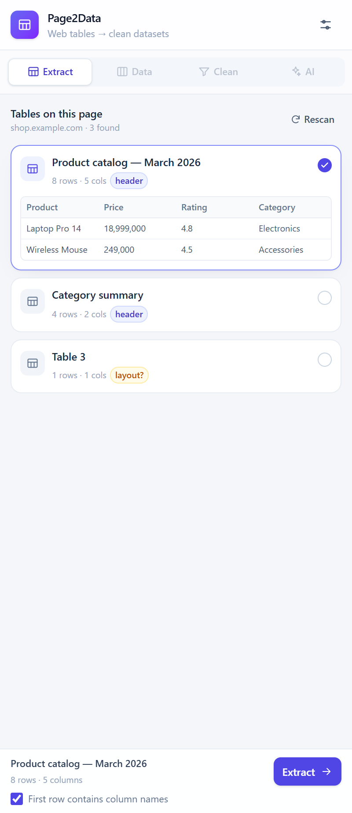
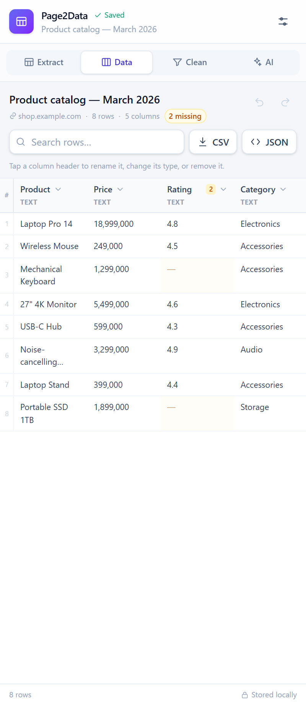
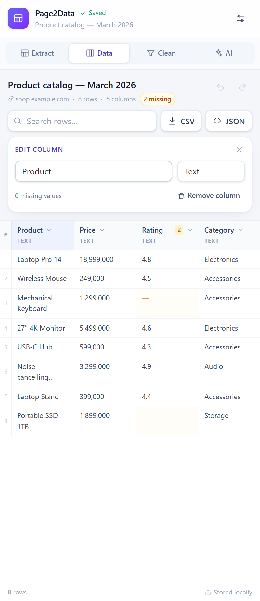
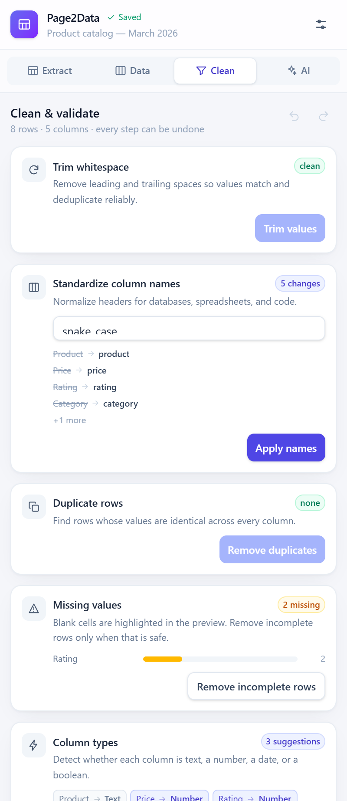
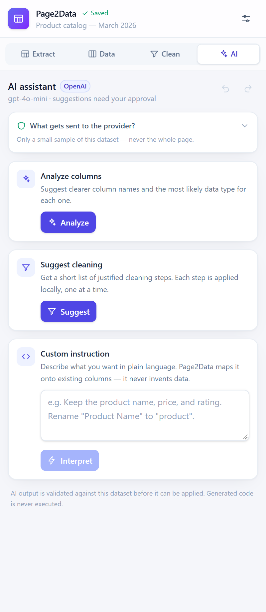
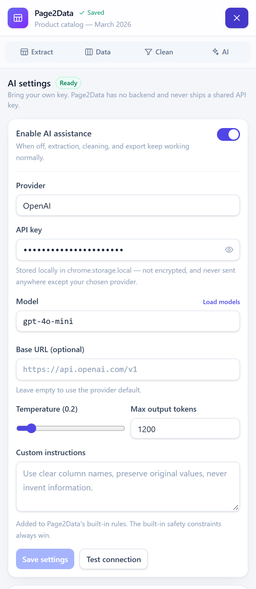

# Page2Data

Turn HTML tables on any webpage into clean, structured datasets — then export them as CSV or JSON.

Page2Data is a local-first Chrome/Edge side-panel extension built with WXT, React, and TypeScript. Extraction, previewing, cleaning, and exporting work entirely in your browser with no account and no backend. AI assistance is optional, bring-your-own-key, and always requires your approval before anything is applied.



## Features

- **Table detection** — scans the active page, ranks real data tables above layout tables, and shows row/column counts plus a preview.
- **Robust grid parsing** — expands `rowspan`/`colspan`, detects single- and multi-row headers, and lets you override the header row before extracting.
- **Dataset preview** — sticky headers, row search, missing-cell highlights, and a column editor for renaming, retyping, or removing columns.
- **Cleaning tools** — trim whitespace, standardize column names (`snake_case`, `camelCase`, `Title Case`), remove duplicate rows, remove incomplete rows, and infer column types.
- **Undo / redo** — every cleaning step is reversible until you open another dataset.
- **CSV export** — RFC 4180 escaping, UTF-8 BOM for Excel, and safe dated filenames.
- **JSON export** — an array of records keyed by the current column names.
- **Local persistence** — datasets are stored in IndexedDB; settings and your API key live in `chrome.storage.local`. There is no Page2Data server, telemetry, or shared key.
- **Optional AI** — analyze columns, suggest cleaning steps, or interpret a plain-language instruction using OpenAI, Google Gemini, or any OpenAI-compatible endpoint.
- **Safe AI application** — responses are validated against the actual dataset, applied one step at a time, and generated code is never executed.

## Requirements

- Node.js 20 or newer and npm
- Chrome, Edge, or another Chromium browser with Manifest V3 support
- Optional: an API key from OpenAI, Google AI Studio, or a local/OpenAI-compatible server

## Quick start

```bash
npm install
npm run dev
```

`npm run dev` starts WXT's development browser with the extension loaded. To target Edge instead:

```bash
npx wxt -b edge
```

### Build and install unpacked

```bash
npm run build
```

The production extension is written to `.output/chrome-mv3`.

1. Open `chrome://extensions` (or `edge://extensions`).
2. Enable **Developer mode**.
3. Choose **Load unpacked** and select the `.output/chrome-mv3` folder.
4. Pin Page2Data to the toolbar.
5. Open a page containing an HTML table and click the Page2Data icon to open the side panel.

When you rebuild, click **Reload** on the extension card to pick up the new build.

## Usage

1. **Extract** — the side panel scans the active page automatically. Select a table, check the preview and header option, then click **Extract**.
2. **Data** — search rows, click a column header to rename it or change its type, and export with the **CSV** or **JSON** buttons.
3. **Clean** — apply trimming, name standardization, deduplication, missing-row removal, or type inference. Use undo/redo freely.
4. **AI** (optional) — configure a provider in Settings, then analyze columns, request cleaning suggestions, or describe what you want in plain language. You choose which suggestions to apply.

Saved datasets appear under **Saved datasets** in the Extract tab and are available until you delete them.

## AI setup

Open **Settings** from the header, enable AI assistance, and fill in:

| Provider | Default base URL | Default model | Where to get a key |
| --- | --- | --- | --- |
| OpenAI | `https://api.openai.com/v1` | `gpt-4o-mini` | [platform.openai.com](https://platform.openai.com/api-keys) |
| Google Gemini | `https://generativelanguage.googleapis.com/v1beta` | `gemini-3.6-flash` | [Google AI Studio](https://aistudio.google.com/app/apikey) |
| OpenAI-compatible | Required (for example `http://localhost:11434/v1`) | `llama-3.1-8b-instruct` | Your server or gateway |

- **OpenAI** requests use the Chat Completions API and retry once without `temperature`/`max_tokens` if the model rejects those parameters.
- **Gemini** requests use the `x-goog-api-key` header and the Gemini `generateContent` endpoint. Gemini 3/4 models request low thinking to keep extraction fast; `gemini-3.6-flash` is the default because it responds reliably on free-tier keys. A previously saved `gemini-3.8-flash` setting is moved to 3.6 once; type 3.8 manually if your account supports it.
- **OpenAI-compatible** covers Ollama, LM Studio, vLLM, OpenRouter, and similar gateways. Enter the full endpoint root, including `/v1` when required by the server.
- Use **Test connection** to verify credentials and **Load models** to populate the model datalist. You can always type a model name manually.
- `Temperature`, `Max output tokens`, and `Custom instructions` are optional. Built-in safety rules always take precedence over custom instructions.

AI is never required. With AI disabled or no key configured, extraction, cleaning, preview, and export continue to work normally.

## Privacy and permissions

### Where data lives

| Data | Storage | Notes |
| --- | --- | --- |
| Extracted datasets | IndexedDB in the extension origin | Stays until you delete it in Settings or clear the extension's data |
| AI settings and API key | `chrome.storage.local` | Plain text, not encrypted |
| Page content | Never stored by Page2Data | Read on demand from the active tab |

### What AI requests contain

AI requests happen only when you click an AI action. A request contains column names and up to 20 sample rows from the current dataset — never the full page, images, browsing history, or other datasets. Expand **What gets sent to the provider?** in the AI tab to inspect the exact prompt text before sending.

The request goes directly from the extension to the provider you configured. Page2Data has no proxy or backend. Your provider's own privacy policy applies to that request.

### API key handling

The key is stored locally without encryption, like most extension settings. Anyone with access to your browser profile can read it. Prefer a scoped or low-limit key, and use **Delete key** in Settings when you no longer need it.

### Permissions

| Permission | Why it is needed |
| --- | --- |
| `storage` | Save datasets, settings, and the API key locally |
| `sidePanel` | Show the main interface in the browser side panel |
| `activeTab` | Read the page you explicitly open the panel on |
| `scripting` | Inject the content script into tabs that were already open when the extension was installed or reloaded |
| `http://*/*`, `https://*/*` host access | Detect and extract HTML tables from regular webpages |

Restricted pages such as `chrome://`, `edge://`, the Chrome Web Store, and browser internal pages cannot be read. There is no analytics, telemetry, or remote configuration.

## Architecture

```
entrypoints/
  background.ts        Opens the side panel when the toolbar icon is clicked
  content.ts           Detects and extracts tables inside the page
  sidepanel/           React shell, routing, and Tailwind styles
components/
  extraction/          Table cards, previews, saved datasets
  dataset/             Data grid and column editor
  cleaning/            Cleaning view and metrics
  ai/                  AI tasks and approval flow
  settings/            BYOK configuration and privacy controls
  layout/ ui/          Header, tabs, buttons, cards, fields, toasts
services/
  extraction/          DOM table -> Dataset (grid expansion, ranking)
  cleaning/            Trim, duplicates, missing values, names, types
  export/              CSV and JSON serializers
  ai/                  Provider adapters, prompts, validation, apply
  browser/             Tab messaging and content-script injection fallback
storage/               IndexedDB datasets and chrome.storage settings
state/                 App context, undo/redo history, save queue
types/                 Shared dataset, extraction, and AI contracts
tests/                 Vitest unit and integration tests
scripts/               Icon generation and screenshot harness
```

### Data flow

1. The content script scans the DOM and returns table metadata to the side panel.
2. Extracting builds a `Dataset` with stable column IDs (`col_1`, `col_2`, …) and rows keyed by those IDs. Renaming a column never breaks row data.
3. Every change goes through the app context, which pushes an undo snapshot and queues a save to IndexedDB.
4. Export maps stable IDs to the current column names, so CSV and JSON always match the preview.
5. AI prompts are built from column names plus a capped sample. The response validator checks returned columns, types, and operations against the real dataset before anything can be applied.

Dataset shape:

```ts
interface Dataset {
  id: string;
  name: string;
  sourceUrl: string;
  sourceTitle: string;
  extractedAt: string;
  columns: Array<{
    id: string;          // stable key, e.g. "col_1"
    name: string;        // editable display name
    originalName: string;
    dataType: 'string' | 'integer' | 'number' | 'boolean' | 'date' | 'empty';
  }>;
  rows: Array<Record<string, string>>; // keyed by column id
}
```

## Scripts

| Command | Description |
| --- | --- |
| `npm run dev` | Start WXT with a development browser |
| `npm run build` | Build the production extension into `.output/chrome-mv3` |
| `npm run zip` | Build and package the extension for distribution |
| `npm run compile` | Type-check with `tsc --noEmit` |
| `npm test` | Run the Vitest suite once |
| `npm run test:watch` | Run Vitest in watch mode |
| `npm run test:page` | Serve the manual test page at `http://127.0.0.1:8080` |
| `npm run icons` | Regenerate the extension icons |
| `npm run screenshots` | Rebuild screenshots from the built side panel |

### Tests

The suite covers extraction (including merged cells and header detection), cleaning, CSV/JSON serialization, AI response validation, and a side-panel integration smoke test.

```bash
npm run compile
npm test
npm run build
```

### Manual test page

`docs/manual-test.html` contains a deterministic set of tables with merged headers, duplicates, missing values, duplicate column names, type-inference samples, layout tables, and hidden tables. Each section lists the expected result.

```bash
npm run test:page
```

Open `http://127.0.0.1:8080/manual-test.html` in Chrome or Edge, then open the Page2Data side panel on that tab. The initial scan should find 8 tables. Use the **Add 2 rows** button and **Rescan** to verify that rescans pick up new content.

### Screenshots

The screenshot harness renders the built side panel in headless Microsoft Edge with a mocked `chrome` API, then writes PNGs to `docs/screenshots/`.

```bash
npm run build
npm run screenshots
```

It expects Edge at `C:/Program Files (x86)/Microsoft/Edge/Application/msedge.exe` and runs on Windows. Adjust `EDGE_PATH` in `scripts/screenshots.mjs` for other installs or platforms.

## Screenshots

| Extract | Data | Column editor |
| --- | --- | --- |
|  |  |  |

| Clean | AI assistant | Settings |
| --- | --- | --- |
|  |  |  |

## Limitations

- Only HTML `<table>` elements are supported. PDFs, images, canvas-rendered tables, and OCR are out of scope for this version.
- Tables rendered by infinite scroll or virtualization may only expose the rows currently in the DOM. Scroll to load more rows, then rescan.
- Scanning happens on demand. Content loaded after the scan requires **Rescan**.
- Merged cells are expanded by repeating values, and nested tables are flagged rather than flattened into the outer table.
- Type inference is heuristic. Values such as phone numbers and IDs with leading zeros stay text; `"1.234"` is treated as `1234` (thousands separator).
- Undo history belongs to the currently open dataset and resets when you open another one.
- Saved datasets are local to this browser profile. There is no cloud sync or account.
- API keys are stored unencrypted in local extension storage.

## License

No license has been added yet. Treat this repository as private until one is chosen.
